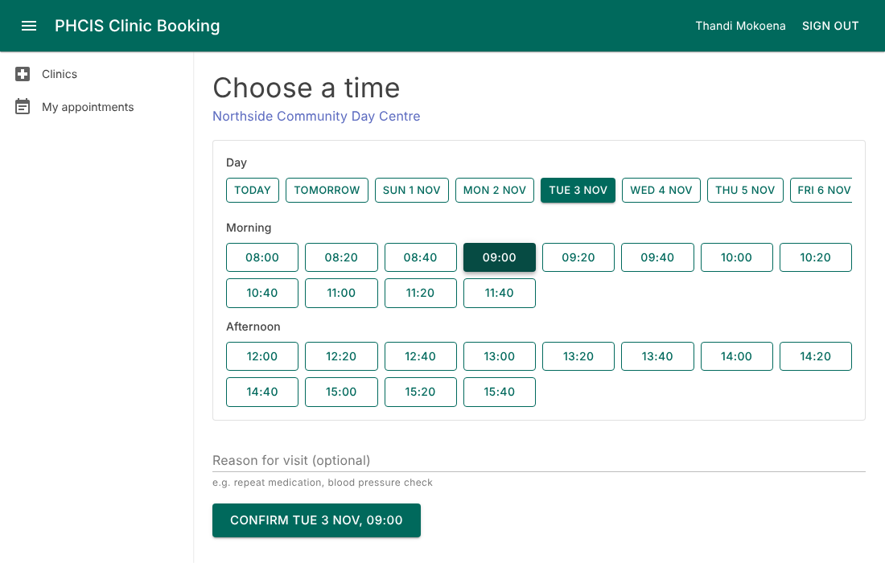
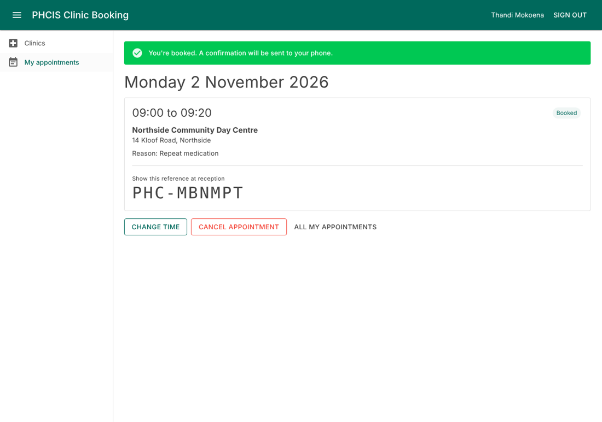
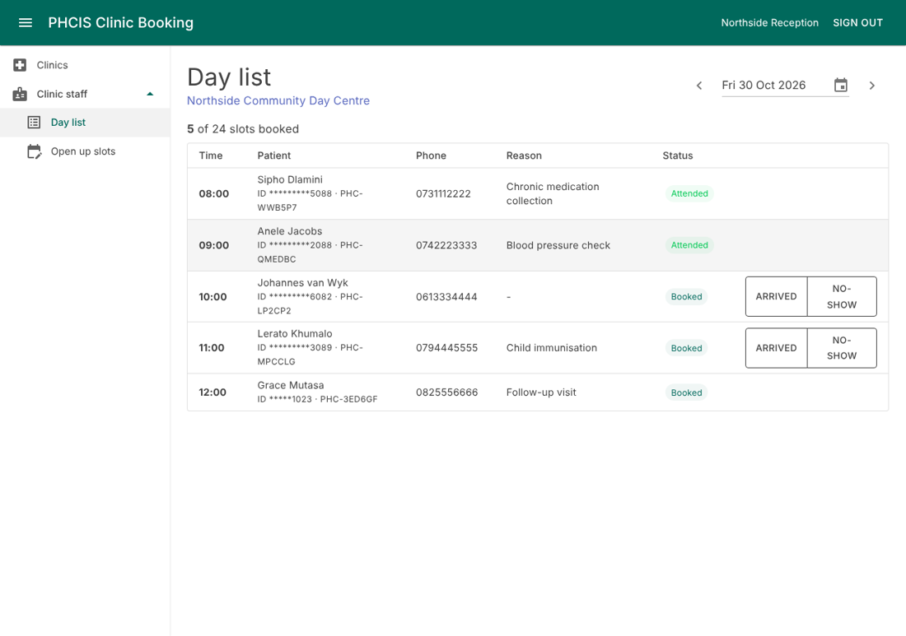

# PHCIS Clinic Booking

A clinic appointment booking system for primary health care. Patients find a free slot at their clinic,
book it, and get a reference to show at reception. They can also cancel or move the booking. Clinic
staff see the day's list, mark who arrived, and open up slots for upcoming days.

Blazor WebAssembly, ASP.NET Core 10 minimal APIs, EF Core and PostgreSQL.

| Booking | Confirmation | Staff day list |
|---|---|---|
|  |  |  |

## Running it

**With Docker** (nothing else needed):

```bash
docker compose up --build
```

Then open http://localhost:8080. The database is migrated and seeded on startup.

**Without Docker** you need the .NET 10 SDK and a Postgres on `localhost:5432` (user and password
`postgres`; change it in `src/Phcis.Booking.Api/appsettings.json`). `docker compose up db` will do.

```bash
dotnet run --project src/Phcis.Booking.Api
```

Then open http://localhost:5069. API docs are at http://localhost:5069/scalar/v1.

### Demo accounts

Password for all of them: `Clinic2026`

| Account | Role |
|---|---|
| `patient@phcis.local` | Patient (Thandi Mokoena) |
| `reception.northside@phcis.local` | Staff at Northside Community Day Centre. Today's list already has a few patients on it. |
| `reception.harbour@phcis.local` | Staff at Harbour View Clinic |

You can also register a new patient. A valid SA ID number fills in the date of birth.
`8001015009087` works. Change the last digit to see the checksum validation fail.

## Tests

```bash
dotnet test
```

- **Unit tests:** domain rules, slot generation across time zones, SA ID validation, the shared
  validators, and bUnit tests for the booking page, slot picker and login form.
- **Integration tests:** the real API against a real Postgres, in a throwaway database per run.
  Covers concurrent double-booking, reschedule rollback, ownership checks, and staff being limited
  to their own clinic. Set `PHCIS_TEST_DB` to point at a different server.

CI runs the same suite on every push, builds with warnings as errors, checks the migrations match the
model, and builds the Docker image.

## Where things are

```
src/
  Phcis.Booking.Domain/    Entities and booking rules. No framework dependencies.
  Phcis.Booking.Shared/    DTOs and validators, shared by API and client.
  Phcis.Booking.Api/       Endpoints, services, EF Core, Identity. Also serves the client.
  Phcis.Booking.Client/    Blazor WebAssembly UI.
tests/
  Phcis.Booking.UnitTests/         Domain, validation, bUnit components.
  Phcis.Booking.IntegrationTests/  API + Postgres.
docs/
  01-requirements.md   Stakeholders, functional and non-functional requirements.
  02-design.md         Architecture, data model (ERD), booking sequence, state diagram, API.
  03-decisions.md      Why things are the way they are, known gaps, what's next.
```

## Main points

If you only read one part of the code, read how double bookings are prevented. There's no
"is it free?" check in the booking path. A partial unique index on `appointments(time_slot_id)` for
slot-holding statuses does the job, and the API turns a violation into a 409 that the UI handles by
refreshing the slot list. `AppointmentConfiguration.cs`, `AppointmentService.cs` and
`BookingTests.Concurrent_bookings_for_the_same_slot_only_one_wins` show it end to end.

Other choices worth knowing about, all explained in [the decisions log](docs/03-decisions.md):

- HttpOnly cookie auth instead of JWT, since the client is served from the same origin.
- No AutoMapper, MediatR or repository layer.
- Validation rules written once and run on both client and server.
- Times stored in UTC and shown in clinic time, whatever the browser's time zone.
