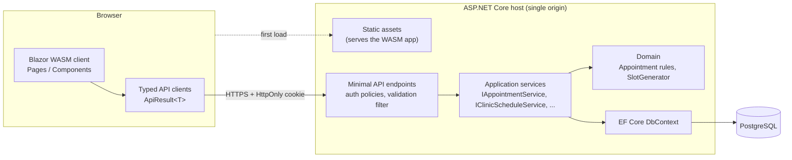
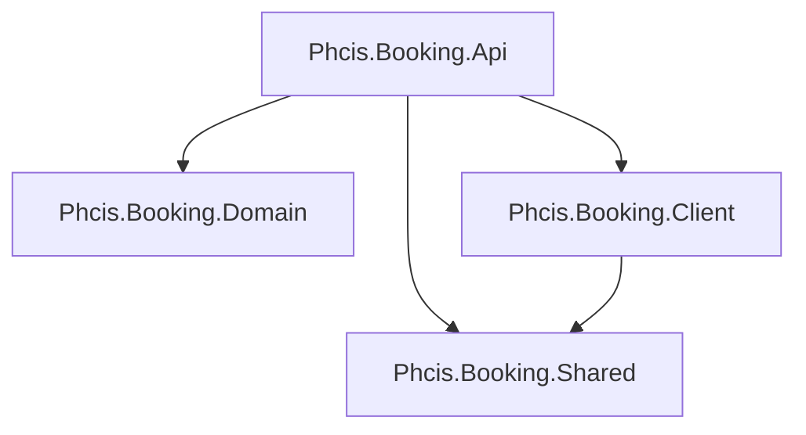
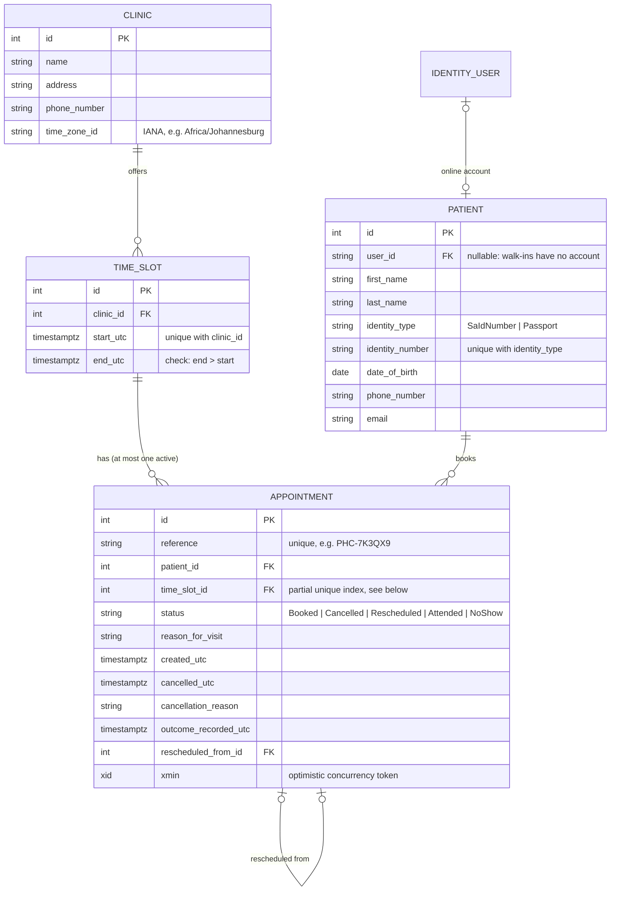
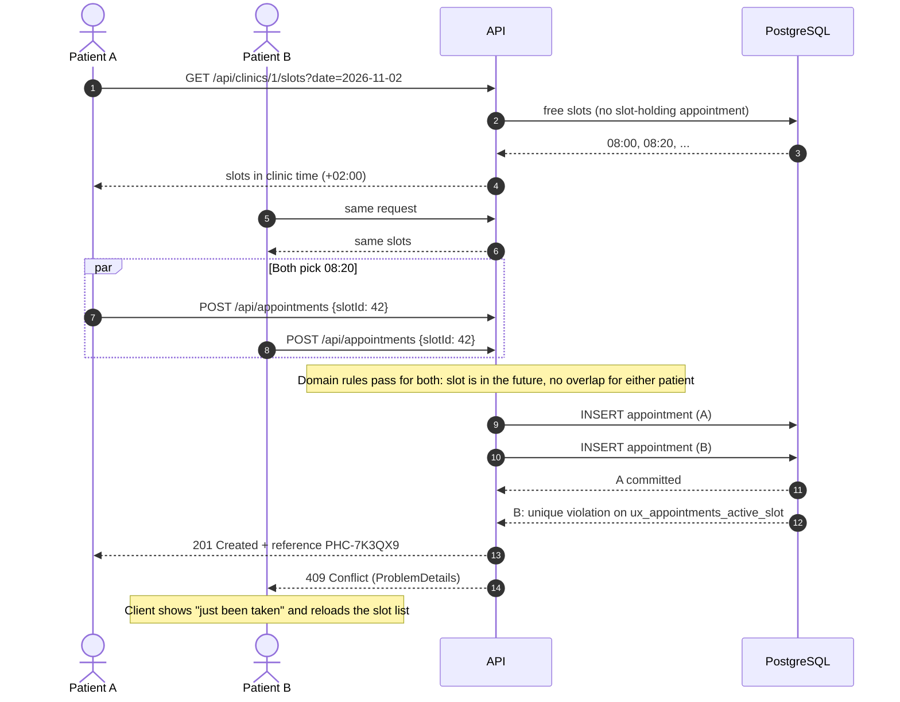
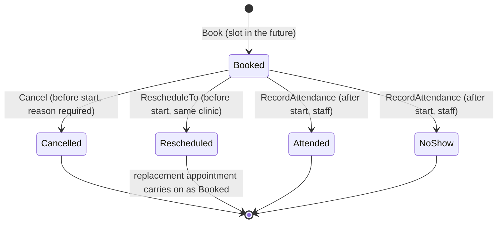

# 2. System design

## Architecture

A layered monolith: one deployable, with the layers kept honest by project references rather than by
folders and good intentions. For a booking system with four core tables, microservices would mostly
mean distributed transactions around the one thing that has to be atomic (taking a slot), so I didn't
go there. The seams are in place if a part ever needs splitting out. Notifications are the obvious
first candidate.

### Projects and dependencies

| Project | What's in it | Depends on |
|---|---|---|
| **Domain** | Entities and the booking rules (`Appointment.Book`, `Cancel`, `RescheduleTo`, `RecordAttendance`), slot generation. No EF, no ASP.NET. | nothing |
| **Shared** | DTOs, request models, FluentValidation validators, SA ID number check, route constants. Used by the API and the browser. | FluentValidation |
| **Api** | Endpoints, application services, EF Core mapping and migrations, Identity, seeding. Also hosts the client. | Domain, Shared, Client |
| **Client** | Blazor WebAssembly UI. | Shared |

The Api references the Client only so it can serve the compiled WASM files. No code goes the other way.

I didn't split Application and Infrastructure into their own projects. There's one database and one
host, and the abstraction that matters for testing (`TimeProvider`, `INotificationService`) is an
interface, not an assembly. I'd split them out the day a second host appeared, such as a background
worker sending reminders.

## Data model

The constraints that carry real weight:

| Constraint | Why |
|---|---|
| `ux_appointments_active_slot`: unique `(time_slot_id) WHERE status IN ('Booked','Attended','NoShow')` | **The double-booking guard.** A slot can collect any number of cancelled or rescheduled appointments, but only one that still holds it. The filter is generated from `AppointmentStatusExtensions.SlotHoldingStatuses`, so the code and the index can't drift apart. |
| `ux_time_slots_clinic_start`: unique `(clinic_id, start_utc)` | Generating slots twice for the same day is harmless. It also serves as the index for "free slots at clinic X on day Y". |
| unique `(identity_type, identity_number)` on patients | One patient record per person. |
| `xmin` row version on appointments | Stops a patient cancelling at the same moment reception marks them as arrived, with the last write silently winning. The loser gets a 409 and a "refresh" message. |
| All FKs `ON DELETE RESTRICT` (patient to user is `SET NULL`) | Appointments are clinical history. Nothing cascades into them. Closing an online account keeps the patient record. |

**Why slots are rows.** The alternative is to store a weekly schedule and work out free times on the
fly. That's less data, but then there's nothing for a booking to point at, and preventing double
bookings means locking or serialisable transactions instead of a unique index. Slot rows also give
staff an obvious way to block a single slot later. The cost is about 25 rows per clinic per day, which
Postgres won't notice.

## Booking flow, including the race

There's deliberately no "is this slot free?" check in the booking code. It would make the happy path
look safer and do nothing for the race. `BookingTests.Concurrent_bookings_for_the_same_slot_only_one_wins`
fires ten bookings at once against real Postgres to prove this.

**Rescheduling** marks the old appointment `Rescheduled` and inserts the new one in a single
`SaveChanges`, which is one transaction. If the new slot is gone, the insert fails, the update rolls
back with it, and the patient keeps their original time.

## Appointment lifecycle

`Cancelled` and `Rescheduled` free the slot. `Attended` and `NoShow` keep holding it, since the time has passed anyway.

## API

| Method | Route | Who | Notes |
|---|---|---|---|
| POST | `/api/account/register` | anyone | Creates account + patient record, signs in. Rate-limited. |
| POST | `/api/account/login` | anyone | Rate-limited, lockout after 5 failures. |
| POST | `/api/account/logout` | signed in | |
| GET | `/api/account/me` | anyone | 200 with user info, or 204 when signed out. |
| GET | `/api/clinics` | anyone | |
| GET | `/api/clinics/{id}/slots?date=` | anyone | Free, future slots for one clinic-local day. |
| GET | `/api/appointments` | patient | Own appointments only. |
| GET | `/api/appointments/{reference}` | patient | Someone else's reference returns 404, not 403. |
| POST | `/api/appointments` | patient | 201, 409 if taken, 422 if a rule fails. |
| POST | `/api/appointments/{reference}/cancel` | patient | |
| POST | `/api/appointments/{reference}/reschedule` | patient | |
| GET | `/api/staff/day-list?date=` | staff | Clinic comes from the staff member's claim, never the request. ID numbers masked. |
| POST | `/api/staff/appointments/{id}/attendance` | staff | |
| POST | `/api/staff/slots` | staff | Idempotent per start time. |
| GET | `/health` | anyone | Includes a database check. |

Errors are always RFC 9457 `ProblemDetails`. Validation errors come back keyed by property name, and
the client shows them next to the matching field. Full OpenAPI at `/openapi/v1.json`, browsable at
`/scalar/v1` in Development.

## Time

- Stored as `timestamptz` in UTC.
- Each clinic has an IANA time zone. Slot generation takes clinic-local times ("08:00 to 16:00") and
  converts them, skipping local times that don't exist (DST gaps; SA has none, but the zone is data).
- DTOs carry `DateTimeOffset` with the **clinic's** offset, so a browser in London still shows 09:00
  for a 09:00 appointment in Cape Town.
- Everything that asks "what time is it?" goes through `TimeProvider`, so tests can pin the clock.

## Client structure

| Piece | Role |
|---|---|
| `CookieAuthenticationStateProvider` | Asks `/api/account/me` who the (HttpOnly) cookie belongs to and caches the answer. Sign-in, sign-out and any 401 update it, and `AuthorizeRouteView` redirects to login. |
| `ApiClientBase` and `IBookingApi` / `IStaffApi` / `IAccountApi` | Typed wrappers that return `ApiResult<T>` instead of throwing. Pages handle success and failure without try/catch, and the interfaces make pages easy to test with bUnit. |
| `FluentValidator<TModel>` | Connects the shared validators to `EditForm`, and can show server-side field errors in the same place. |
| `SlotPicker`, `AppointmentCard`, `StatusChip`, `CancelAppointmentDialog` | Reusable components. `SlotPicker` supports `@bind-SelectedSlotId`. |
